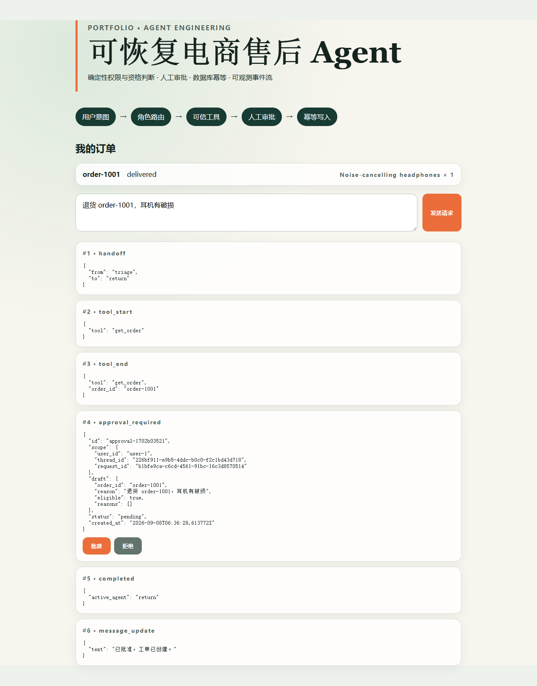

# 基于 LangGraph 的可恢复电商售后多 Agent 系统

这是一个面向 LLM 应用工程实习作品集的独立实现。它参考了 Anthropic
`commerce-agents` 对工具安全、运行时复用和人工审批的设计，但没有复制其双角色、
三运行时和四行业演示。个人实现聚焦一个能被测试证明的售后闭环：

```text
用户请求 → triage 路由 → order / return / policy
                     ↓
     权限检查 → 确定性资格规则 → 待审批草稿
                                      ↓
                         人工批准 → UNIQUE(request_id) 幂等建单
```

## 为什么不是“让模型直接操作数据库”

模型擅长理解自然语言和选择能力，不适合承担权限、资格和 exactly-once 语义。
本项目把这些不变量放在代码和数据库中：

- `user_id` 决定数据所有权；不存在和无权限使用相同外部错误。
- `thread_id` 标识对话；`request_id` 标识业务操作，二者不混用。
- 退货资格由纯函数判断，不由模型决定。
- 写操作先产生 `Approval`，批准后才调用数据库写入。
- `tickets.request_id UNIQUE` 是最终防线；重复批准返回同一张工单。

## 运行

要求 Python 3.12+、uv、Node 22+。

```powershell
uv sync
uv run python -m scripts.seed
uv run pytest
uv run python scripts/demo.py
uv run uvicorn commerce_support.api:app --reload

cd web
npm ci
npm run dev
```

演示账号：`demo / demo-password`。仅用于本地演示，认证实现不是生产 IAM。

## 环境变量

以 `.env.example` 为唯一清单。生产工厂要求 `APP_SECRET`，并分别使用 `BUSINESS_DB` 与
`CHECKPOINT_DB`；`WEB_DIST` 指向前端构建目录。`LLM_EMBEDDING_MODEL` 选择语义向量模型。
只有显式设置 `RUN_REAL_MODEL_EVAL=1` 且提供服务端 API key，真实 LLM 评测才会运行。

## 测试与评测

```powershell
uv run ruff check .
uv run ruff format --check .
uv run mypy
uv run pytest
uv run python -m evals.run --suite v1
uv run python -m evals.load_smoke
cd web
npm test
npm run typecheck
npm run build
npm run e2e
```

当前已保存的 v1 RAG 报告含 30 条样本：离线 Hash stub 与本机
`fastembed:BAAI/bge-small-en-v1.5` 语义检索的 Hit@1、Hit@3、MRR、引用合法率和拒答召回均为
1.0。两者均标记 `real_model_used=false`，不能表述成真实 LLM 效果。精确环境与测试数量见
`artifacts/verification.json`。

### 生产工厂与容器

生产启动必须提供至少 16 字符的 `APP_SECRET`，并使用环境工厂；前后端以同源方式由
FastAPI 提供，业务库与 checkpoint 库挂载到独立路径：

```powershell
$env:APP_SECRET = "replace-with-a-long-random-secret"
$env:BUSINESS_DB = ".\data\business.db"
$env:CHECKPOINT_DB = ".\data\checkpoints.db"
$env:WEB_DIST = ".\web\dist"
$env:LLM_EMBEDDING_MODEL = "fastembed:BAAI/bge-small-en-v1.5"
uv run uvicorn commerce_support.api:create_app_from_env --factory --host 0.0.0.0 --port 8000
```

安装 Docker 的环境可执行 `docker compose up --build`。SQLite 数据保存在命名卷
`commerce-data`；`/health` 同时作为容器健康检查。不得把本机进程验收写成云端部署。

## API

| 方法 | 路径 | 作用 |
|---|---|---|
| `GET` | `/health` | 健康检查 |
| `POST` | `/login` | 获取短期签名 token |
| `GET` | `/orders` | 查询当前用户订单 |
| `GET` | `/orders/{id}` | 所有权保护的订单详情 |
| `GET` | `/orders/{id}/logistics` | 所有权保护的结构化物流信息 |
| `POST` | `/chat` | 返回结构化 SSE Agent 事件 |
| `GET` | `/chat/{thread_id}/events` | 用户隔离的持久事件 replay |
| `GET` | `/threads/{thread_id}` | 当前角色与事件数量快照 |
| `GET` | `/approvals` | 查询当前用户审批 |
| `POST` | `/approvals/{id}/decide` | 批准或拒绝并幂等建单 |

## 事件协议

每个正常事件都有 `run_id`、`thread_id`、`user_id` 和单调递增 `seq`。事件类型为
`message_update`、`tool_start`、`tool_end`、`handoff`、`approval_required`、
`completed`、`error`。这让 UI 不必从自然语言猜测 Agent 当前状态。

## 验证边界

- 默认路由与 RAG 使用确定性离线实现，因此 CI 不消耗模型额度。
- `OfflinePolicyRetriever` 是测试替身，不是生产语义检索；不得把它的指标写成真实模型效果。
- 当前 SQLite 适合单机演示，不代表多实例生产环境。
- 当前 token 是演示级 HMAC token，不替代 OAuth、会话吊销和生产密钥管理。
- 不连接真实支付、退款或物流系统。
- 本机未安装 Docker，因此 Dockerfile/Compose 已实现但镜像未实际构建；也没有云端上线证据。
- 当前环境无 LLM API key，真实路由成功率、延迟与 token 指标不存在。

## 演示界面

Playwright 会在真实 Chromium 中验证订单历史、流式退货请求、审批与唯一成功结果；失败时在
`web/test-results/` 保存截图和 trace。仓库不把临时测试截图当作生产部署证明。



需要刷新截图时，在 `web/` 下运行：

```powershell
$env:CAPTURE_DEMO = "1"
npm run e2e
Remove-Item Env:CAPTURE_DEMO
```

详细材料：

- [上游源码深度剖析](docs/upstream-analysis.zh-CN.md)
- [贡献与证据矩阵](docs/evidence-matrix.zh-CN.md)
- [简历与面试材料](docs/resume-interview-kit.zh-CN.md)
